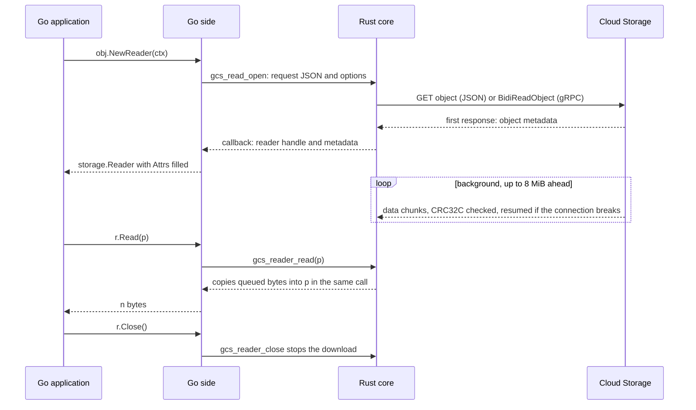

# Go SDK on the shared Rust core (FFI proof of concept)

**Experimental, not a supported API.** This POC serves the Go Cloud Storage SDK
(`cloud.google.com/go/storage`) from one Rust core, `gcs_core`, built on this repository's
`google-cloud-storage` crate. Go calls the core in-process through cgo (FFI). The Go public API is
unchanged; Go programs opt in with `experimental.WithRustCore()` and the `gcsrust` build tag.

```text
Go application ── storage.Client (public API, unchanged)
                    └─ rustStorageClient ─ existing Go <-> v2 proto mapping, Go-only API semantics
                         └─ cgo bridge: generic, no storage logic (bytes in, bytes out)
                              └─ C ABI (gcs_core.h): ~20 functions, proto3-JSON requests and responses
                                   └─ gcs_core (Rust): transport, auth, retries, idempotency, uploads,
                                      checksums, read resumption, errors
                                        └─ google-cloud-storage 1.20 ──► Cloud Storage (JSON / gRPC)
```

## Layout

| Path | What |
|---|---|
| [`gcs_core/`](gcs_core) | The Rust core: a standalone static-library crate (not part of this workspace), pinned to the published `google-cloud-storage` 1.20 crates it was tested with |
| [`gcs_core.h`](gcs_core.h) | The C ABI: the contract any language binds to |
| [`build.sh`](build.sh) | Builds the core; optionally installs it into a google-cloud-go checkout |
| [`go/`](go) | The Go side: a patch against google-cloud-go, an apply script, and instructions |

## What runs in Rust

Every storage operation of the Go SDK runs here, once, so that every language binding would get
the same behavior:

- **Calls.** All 17 unary v2 RPCs (bucket and object metadata, list, compose, rewrite, move,
  restore, IAM) go through one generic entry point, `gcs_call(method, request, options)`. Object
  reads and writes use streaming handles.
- **Retries.** The caller's retry policy, attempt and time limits, backoff and retry predicate
  (evaluated through a callback), plus per-RPC idempotency rules decided from the request.
- **Uploads and reads.** Single-request or resumable uploads that never commit a partial object.
  Reads with CRC32C validation, resumption after broken connections, and decompressive
  transcoding.
- **Auth.** Any Go credential, bridged through a token callback; Rust caches the token.
- **Errors.** Every failure carries both its gRPC code and its HTTP status.
- **JSON listing.** `storage.objects.list`, which the Rust SDK does not offer (its control plane
  is gRPC-only), implemented on the SDK's own retry loop and error types.
- **Embedding safety.** Panics are caught at every entry point, and async operations complete
  exactly once. Handle lifetimes are safe under concurrent close. SIGPIPE is blocked on the core's
  threads: a static library inside a Go program does not inherit Rust's `main()` setup, and an
  unblocked SIGPIPE kills the whole process.

| | `storage.NewClient` + `WithRustCore` | `storage.NewGRPCClient` + `WithRustCore` |
|---|---|---|
| Reads | JSON API | gRPC `BidiReadObject` (CloudPath) |
| Listing | JSON API (implemented in the core) | gRPC v2 `ListObjects` |
| Uploads | JSON API | JSON API: the Rust SDK has no gRPC upload for standard buckets |

## How reads and writes work

The `storage.Reader` and `storage.Writer` that Go users get are the usual types. Underneath,
network I/O, buffering, retries and checksums run in the core on its own threads. Go hands buffers
across and waits on channels; no OS thread is blocked while waiting for the network.

### Reads: `obj.NewReader(ctx)`, `r.Read(p)`, `r.Close()`



1. **Open.** Go sends the read request (bucket, object, range, generation, preconditions,
   encryption key) and the caller's options. The core sends it and waits for the first response.
   `NewReader` returns once Cloud Storage has answered, so errors such as "not found" or a failed
   precondition surface there, as before.
2. **Background download.** A core task pulls data into a queue, at most 8 MiB ahead of the
   reader; when the application stops reading, it stops too. The Rust SDK validates the CRC32C,
   resumes from the last byte after a broken connection (within the retry settings), and
   decompresses gzip objects when requested.
3. **`Read(p)`.** Go pins `p` and makes one call into the core. If data is queued, the core copies
   it into `p` within that call (no callback, no goroutine switch). If not, the goroutine parks on
   a channel; the core copies arriving data straight into `p` (batched up to 256 KiB, except the
   first delivery) and calls back. End of object is `io.EOF`; a cancelled `ctx` returns
   `ctx.Err()`. `io.Copy` reads in 1 MiB pieces.
4. **`Close()`.** The core stops the download; a `Read` in progress on another goroutine fails
   cleanly.

### Writes: `obj.NewWriter(ctx)`, `w.Write(p)`, `w.Close()`

```mermaid
sequenceDiagram
    participant U as Go application
    participant G as Go side
    participant R as Rust core
    participant S as Cloud Storage
    U->>G: w := obj.NewWriter(ctx)
    U->>G: first w.Write(p)
    G->>R: gcs_write_open: object spec JSON and options, starts the upload task
    G->>R: gcs_writer_write(piece)
    R-->>G: copied into the queue, same call or later if the queue was full
    G-->>U: n
    Note over R,S: holds up to 16 MiB; beyond that, a resumable upload in 16 MiB chunks
    R->>S: resumable chunks, only for large objects
    U->>G: w.Close()
    G->>R: gcs_writer_close sends Finish
    R->>S: single request, or the last chunk
    S-->>R: created object
    R-->>G: callback: object JSON
    G-->>U: nil, w.Attrs() filled
```

1. **`NewWriter`** is pure Go. On the first `Write`, Go sniffs the Content-Type if it is unset
   (from the first 512 bytes, as before). It then sends the object spec (attributes,
   preconditions, predefined ACL, encryption key, user checksums) and options (`ChunkSize`,
   retries). The core creates a bounded queue (8 pieces) and an upload task; nothing is sent yet.
2. **`Write(p)`.** Go merges small writes (under 16 KiB) into a 256 KiB buffer and splits large
   ones into pieces of at most 1 MiB. If the queue has room, the core copies a piece within the
   call and `Write` returns at once. If not, the copy happens when room frees up and `Write` waits:
   that backpressure bounds memory. When `Write` returns, the core has accepted the bytes, not
   necessarily uploaded them; as before, errors can surface on a later `Write` or on `Close`.
3. **Upload.** The task collects data until it has more than `ChunkSize` (16 MiB by default) or
   `Close` arrives. If `Close` comes first, the object goes in one request with a known size.
   Otherwise it becomes a resumable upload in `ChunkSize` chunks; the Rust SDK retries and
   resumes it under the caller's retry policy. The CRC32C is computed in the core and verified by
   Cloud Storage.
4. **`Close()`.** The core sends "finish", the SDK completes the upload, and the created object
   comes back to fill `w.Attrs()`.
5. **Cancel, `CloseWithError`, or a Writer dropped without `Close`.** The upload task is aborted
   before "finish", so the SDK never finalizes it: no partial object is ever created.

Each direction copies the data once: from the core's queue into `p` on reads, from `p` into the
core's queue on writes.

## Status

- **Tests.** 29 tests pass under the Go race detector: 21 against real GCS (including parity with
  Go's own JSON and gRPC clients) and 8 hermetic tests. Go's existing unit tests still pass, and
  the module still builds without cgo.
- **Benchmarks.** The harness (7 client setups, 15 read/range/write/list cases) and the GCE VM
  scripts are in the Go patch. **They have not been run yet.**
- **Known gaps (Rust SDK).** No gRPC uploads to standard buckets; no JSON listing; the JSON
  transport is HTTP/1.1-only; no DirectPath; no per-call headers on reads and writes.
- **Platforms.** Linux x86-64 only so far.

## Quick start

```sh
./build.sh                                   # build the core (~3 min, release with LTO)
# Go side: see go/README.md (apply the patch to google-cloud-go, build, test)
```
