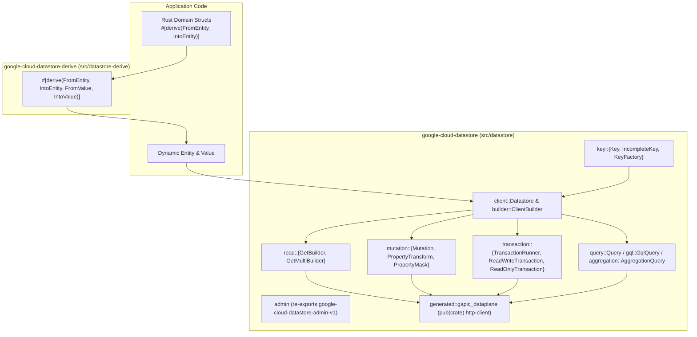
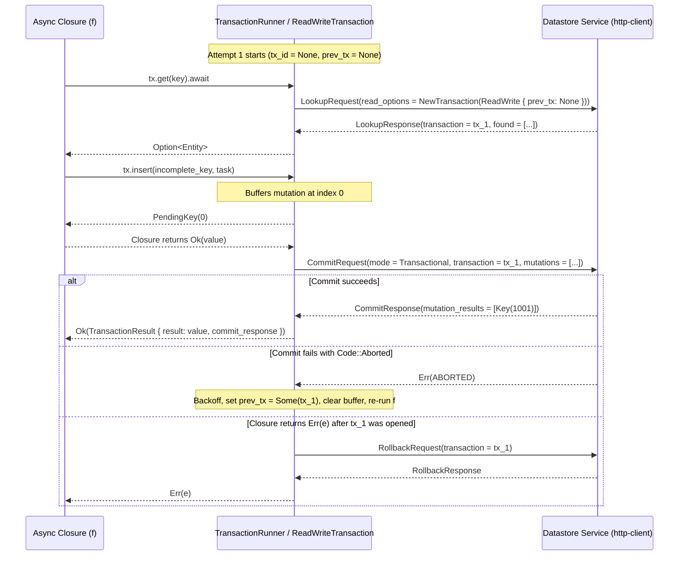

# Cloud Datastore Rust Client Library Specification (`google-cloud-datastore`)

**Status:** Draft Specification **Crates Covered:** `google-cloud-datastore`
(`src/datastore`), `google-cloud-datastore-derive` (`src/datastore-derive`), and
`google-cloud-datastore-admin-v1` (`src/generated/datastore/admin/v1`) **APIs
Covered:** `google.datastore.v1` (Data Plane) & `google.datastore.admin.v1`
(Control Plane) **Language-Agnostic Reference Specification:**
`https://artifax.corp.goog/aa90b6a18f4dae3e`

______________________________________________________________________

## 1. Overview & Architecture

`google-cloud-datastore` provides an idiomatic, asynchronous Rust veneer over
the Google Cloud Datastore v1 API (`google.datastore.v1`), paired with a
companion procedural macro crate `google-cloud-datastore-derive` and a re-export
of the generated Admin GAPIC crate `google-cloud-datastore-admin-v1`.

### 1.1 Crate & Module Organization

Following the conventions of `google-cloud-bigquery` (`src/bigquery` +
`src/bigquery-derive`), `google-cloud-spanner` (`src/spanner`), and
`google-cloud-pubsub` (`src/pubsub`), the library is organized into:

1. **`google-cloud-datastore` (`src/datastore`):**
   - `pub mod client`: `Datastore` client and high-level entrypoints.
   - `pub mod builder`: `ClientBuilder` and request builders (`GetBuilder`,
     `GetMultiBuilder`, `MutateBuilder`, `RunQueryBuilder`,
     `RunAggregationQueryBuilder`, `TransactionRunnerBuilder`).
   - `pub mod admin`: Re-exports
     `google_cloud_datastore_admin_v1::{builder, client, model}`
     (`DatastoreAdmin` control-plane client for index management, entity
     import/export Long-Running Operations, and Firestore migration state).
   - `pub mod key`: `PartitionId`, `KeyId`, `PathElement`, `Key` (complete),
     `IncompleteKey` (incomplete leaf), `KeyFactory`, and `IntoMutationKey`.
   - `pub mod value`: `Value`, `ValueKind`, `GeoPoint`, `FromValue`, and
     `IntoValue`.
   - `pub mod entity`: `Entity`, `FromEntity`, and `IntoEntity`.
   - `pub mod read`: `ReadOptions` and `ReadConsistency` (`Strong`, `Eventual`).
   - `pub mod mutation`: `Mutation`, `MutationKind`, `PropertyTransform`,
     `ServerValue`, `PropertyMask`, `CommitResponse`, and `MutationResult`.
   - `pub mod transaction`: `TransactionRunner`, `ReadWriteTransaction`,
     `ReadOnlyTransaction`, `PendingKey`, `TransactionResult`, and
     `TransactionRetryPolicy`.
   - `pub mod query`: `Query`, `Filter`, `PropertyFilter`, `Operator`,
     `CompositeFilter`, `Direction`, `Order`, `Cursor`, `QueryStream`,
     `EntityItem`, and `BatchMoreResults`.
   - `pub mod gql`: `GqlQuery` and `GqlParameter`.
   - `pub mod aggregation`: `AggregationQuery`, `Aggregation`, and
     `AggregationResults`.
   - `pub mod explain`: `ExplainOptions`, `ExplainMetrics`, `PlanSummary`, and
     `ExecutionStats`.
   - `pub mod error`: Re-exports `google_cloud_gax::error::Error` and
     `Result<T>`, plus `DataError` (`ValueError`, `EntityError`, `KeyError`) for
     data conversion and key validation errors.
   - `mod generated` (`pub(crate)`): Internal `http-client` GAPIC generated by
     `librarian` at `src/datastore/src/generated/gapic_dataplane` for
     `.google.datastore.v1.Datastore`.
1. **`google-cloud-datastore-derive` (`src/datastore-derive`):**
   - Procedural macro crate providing
     `#[derive(FromEntity, IntoEntity, FromValue, IntoValue)]` with
     `#[datastore(...)]` field and container attributes.
   - Re-exported from the root of `google-cloud-datastore`.



### 1.2 Transport Selection (`http-client` vs. `grpc-client`)

All 8 RPCs in `google.datastore.v1.Datastore` (`Lookup`, `RunQuery`,
`RunAggregationQuery`, `BeginTransaction`, `Commit`, `Rollback`, `AllocateIds`,
`ReserveIds`) are unary RPCs with HTTP/JSON
`POST /v1/projects/{project_id}:<verb>` bindings; there are no server-, client-,
or bidirectional-streaming RPCs in `google.datastore.v1` or
`google.datastore.admin.v1`.

Accordingly, `google-cloud-datastore` generates its internal data-plane stub
(`src/datastore/src/generated/gapic_dataplane`) using `librarian`'s
`http-client` template (`gaxi::http::ReqwestClient`):

- Zero `tonic` gRPC runtime overhead is required.
- The generated `gapic_dataplane::stub::Datastore` trait provides an internal
  seam that can be mocked directly in unit tests via `mockall`.
- The generated transport automatically formats `x-goog-request-params`
  (`project_id=...&database_id=...`) from the protobuf `google.api.routing`
  annotations on every request.

______________________________________________________________________

## 2. Summary of Design Decisions (Mapping from Language-Agnostic Spec)

| Language-Agnostic Spec Question                  | Rust Decision in `google-cloud-datastore`                                                                                                                                                                                                                                                                                                                                                                                                                                                                                                                         |
| :----------------------------------------------- | :---------------------------------------------------------------------------------------------------------------------------------------------------------------------------------------------------------------------------------------------------------------------------------------------------------------------------------------------------------------------------------------------------------------------------------------------------------------------------------------------------------------------------------------------------------------- |
| **§2 Admin vs. Data Plane GAPIC**                | Re-export `google-cloud-datastore-admin-v1` under `google_cloud_datastore::admin`; generate `google.datastore.v1.Datastore` internally via `template: http-client` at `src/datastore/src/generated/gapic_dataplane` (`pub(crate)`).                                                                                                                                                                                                                                                                                                                               |
| **§4.2 Static vs. Unified Key Representation**   | **Static separation** between `Key` (guaranteed complete: every path element has a valid non-zero `Id(i64)` or non-empty `Name(String)`) and `IncompleteKey` (ancestor path of complete `PathElement`s plus a leaf `kind: String`). Operations requiring complete keys (`get`, `get_multi`, `update`, `delete`, `reserve_ids`, `has_ancestor`, parent keys) accept `Key` and reject `IncompleteKey` at compile time. `insert` and `upsert` accept `impl IntoMutationKey` (implemented for `Key` and `IncompleteKey`). `allocate_ids` maps `IncompleteKey -> Key`. |
| **§4.4 URL-Safe Key Serialization**              | **Omitted in initial release** to minimize external dependencies (avoiding a `prost` dependency solely to wire-encode `google.datastore.v1.Key` in an HTTP/JSON-based crate); can be added non-breakingly later if needed. `Cursor::to_url_safe` / `Cursor::from_url_safe` are provided because cursors are already opaque `bytes::Bytes`.                                                                                                                                                                                                                       |
| **§5.1 & §5.4 Entity Modeling & Struct Mapping** | Provide **both** the core dynamic `Entity` (`get`/`take`/`set`) + `Value` (`FromValue`/`IntoValue`) model **and** a companion proc-macro crate `google-cloud-datastore-derive` with `#[derive(FromEntity, IntoEntity, FromValue, IntoValue)]` supporting `#[datastore(rename = "...", rename_all = "...", exclude_from_indexes, key, default, flatten)]`.                                                                                                                                                                                                         |
| **§8.1 & §8.4 Transaction Surface**              | Provide closure-based `TransactionRunner` (`client.read_write_transaction()...run(async \|tx\| ...)`) and `ReadOnlyTransaction` (`client.read_only_transaction()`) following `google-cloud-spanner`. **Omit manual/unscoped transaction handles** (`begin_transaction`) so locks cannot be leaked and `previous_transaction` retry tokens are never dropped.                                                                                                                                                                                                      |
| **§9.2 GQL Queries**                             | Support both Structured `Query` and `GqlQuery` (with named `@name` and positional `@1` bindings, `allow_literals`, and automatic multi-batch continuation using the server-compiled `RunQueryResponse.query`).                                                                                                                                                                                                                                                                                                                                                    |
| **§12 Legacy Features**                          | Exclude legacy App Engine v3 `storage_onestore_v3.Reference` `urlsafe` key decoding, client-side `Query.Count` pagination fallback, and web framework session stores.                                                                                                                                                                                                                                                                                                                                                                                             |

______________________________________________________________________

## 3. Client Configuration, Partition Context & Transport

### 3.1 `Datastore` Client & `ClientBuilder`

The `Datastore` client is cheaply cloneable (`#[derive(Clone, Debug)]`, wrapping
an `Arc` internally) and is bound to a default partition context:

- `project_id: String` (required, non-empty)
- `database_id: String` (optional, defaults to `""` representing the default
  database)
- `namespace_id: String` (optional, defaults to `""` representing the default
  namespace)

```rust
pub struct Datastore {
    pub(crate) inner: Arc<DatastoreInner>,
}

impl Datastore {
    /// Returns a builder for constructing a [Datastore] client bound to `project_id`.
    pub fn builder(project_id: impl Into<String>) -> ClientBuilder;

    /// Returns the Google Cloud project ID bound to this client.
    pub fn project_id(&self) -> &str;

    /// Returns the Datastore database ID bound to this client (`""` for the default database).
    pub fn database_id(&self) -> &str;

    /// Returns the default multi-tenant namespace ID bound to this client (`""` for default).
    pub fn namespace_id(&self) -> &str;

    /// Returns a [KeyFactory] pre-configured with this client's partition context.
    pub fn key_factory(&self, kind: impl Into<String>) -> KeyFactory;
}
```

`ClientBuilder` provides configuration methods consistent with
`google-cloud-gax` and `google-cloud-spanner`:

```rust
impl ClientBuilder {
    pub fn with_database_id(self, database_id: impl Into<String>) -> Self;
    pub fn with_namespace_id(self, namespace_id: impl Into<String>) -> Self;
    pub fn with_endpoint(self, endpoint: impl Into<String>) -> Self;
    pub fn with_credentials(self, credentials: auth::credentials::Credentials) -> Self;
    pub fn with_retry_policy(self, policy: impl Into<RetryPolicyArg>) -> Self;
    pub fn with_backoff_policy(self, policy: impl Into<BackoffPolicyArg>) -> Self;
    pub fn with_retry_throttling(self, policy: impl Into<RetryThrottlingArg>) -> Self;
    pub async fn build(self) -> ClientBuilderResult<Datastore>;
}
```

### 3.2 Partition Normalization & Routing Headers

1. **Default Partition Filling:** When a `Key` or `IncompleteKey` has an empty
   `PartitionId.project_id`, the client automatically stamps its configured
   `project_id` (and if `database_id` / `namespace_id` are unset on a
   client-relative key, stamps the client's `database_id` and `namespace_id`)
   before serializing the key to protobuf. If a key explicitly specifies a
   non-empty `project_id` or `database_id` that differs from the client's
   `project_id` or `database_id` on a top-level mutation or lookup, the client
   returns an invalid-argument `Error` before sending the RPC.
1. **Routing Headers:** The generated `gapic_dataplane` transport populates
   `x-goog-request-params` (`project_id={url_encoded_project_id}` when
   `database_id` is empty, or
   `project_id={url_encoded_project_id}&database_id={url_encoded_database_id}`
   when non-empty) on every RPC.

### 3.3 Cloud Datastore Emulator Support (`DATASTORE_EMULATOR_HOST`)

During `ClientBuilder::build()`:

- If `std::env::var("DATASTORE_EMULATOR_HOST")` is set to a non-empty
  `host:port` string:
  - Unless the caller explicitly called `.with_endpoint(...)`, the builder sets
    the endpoint to `http://{host:port}` (preserving `http://` or `https://` if
    already present).
  - Unless the caller explicitly called `.with_credentials(...)`, the builder
    configures
    `google_cloud_auth::credentials::anonymous::Builder::new().build()` so no
    ADC token exchange is attempted against the local emulator.

### 3.4 RPC Idempotency & Default Retry Policy

Per `datastore_grpc_service_config.json` and Section 3.4 of the
language-agnostic spec:

- **Idempotent RPCs (`Lookup`, `RunQuery`, `RunAggregationQuery`,
  `ReserveIds`):** Retried automatically at the RPC layer on transient
  `Code::Unavailable` and `Code::DeadlineExceeded` errors using exponential
  backoff (`initial_backoff = 100ms`, `max_backoff = 60s`, `multiplier = 1.3`).
- **Non-Idempotent RPCs (`BeginTransaction`, `Commit`, `Rollback`,
  `AllocateIds`):** Marked non-idempotent at the RPC layer
  (`set_default_idempotency(options, false)`). Read-write transaction contention
  (`Code::Aborted`) is retried by re-running the entire transaction closure in
  `TransactionRunner` with `previous_transaction`.

______________________________________________________________________

## 4. Keys & Key ID Management

### 4.1 Static Key Hierarchy (`Key` vs. `IncompleteKey`)

Datastore distinguishes between **complete keys** (every path element has a
non-zero `i64` ID or non-empty `String` name) and **incomplete keys** (the leaf
element has only a `kind`, awaiting server-side ID allocation).

To prevent runtime bugs where an incomplete key is passed to `get`, `update`,
`delete`, `reserve_ids`, or used as a parent key, `google-cloud-datastore` uses
distinct static types:

```rust
/// Identifies the project, database, and namespace partition of a key or query.
#[derive(Clone, Debug, Default, PartialEq, Eq, PartialOrd, Ord, Hash)]
pub struct PartitionId {
    project_id: String,
    database_id: String,
    namespace_id: String,
}

/// The identifier of a complete [PathElement].
#[derive(Clone, Debug, PartialEq, Eq, PartialOrd, Ord, Hash)]
#[non_exhaustive]
pub enum KeyId {
    /// A non-zero 64-bit signed integer ID.
    Id(i64),
    /// A non-empty UTF-8 string name.
    Name(String),
}

/// A complete element in a Datastore key path.
#[derive(Clone, Debug, PartialEq, Eq, PartialOrd, Ord, Hash)]
pub struct PathElement {
    kind: String,
    id: KeyId,
}

/// A guaranteed-complete Datastore key.
///
/// Every element in `path` (both ancestors and the leaf element) has a valid [KeyId].
#[derive(Clone, Debug, PartialEq, Eq, PartialOrd, Ord, Hash)]
pub struct Key {
    partition_id: PartitionId,
    /// Guaranteed non-empty; the last element is the leaf key element.
    path: Vec<PathElement>,
}

/// An incomplete Datastore key whose leaf element has a `kind` but no ID or name.
///
/// Used when allocating IDs ([Datastore::allocate_ids]) or inserting new entities
/// ([Datastore::insert], [Datastore::upsert]) with server-assigned numeric IDs.
#[derive(Clone, Debug, PartialEq, Eq, PartialOrd, Ord, Hash)]
pub struct IncompleteKey {
    partition_id: PartitionId,
    /// Zero or more complete ancestor path elements.
    ancestors: Vec<PathElement>,
    /// The non-empty kind of the leaf element.
    kind: String,
}
```

#### Key Invariants & Methods:

- Constructing a `KeyId::Id(0)` or `KeyId::Name("")` or an empty `kind` via
  fallible constructors returns `Err(KeyError)`.
- `Key` provides:
  - `Key::new(kind, id: impl Into<KeyId>) -> Result<Key, KeyError>`
  - `key.kind() -> &str`
  - `key.id() -> &KeyId`
  - `key.id_num() -> Option<i64>` and `key.name() -> Option<&str>`
  - `key.partition_id() -> &PartitionId`
  - `key.path() -> &[PathElement]`
  - `key.parent() -> Option<Key>` (returns the parent `Key` if `path.len() > 1`)
  - `key.ancestors() -> impl Iterator<Item = Key>`
  - `key.has_ancestor(&self, ancestor: &Key) -> bool` (verifies matching
    `PartitionId` and that `ancestor.path()` is a prefix of `self.path()`)
  - `key.with_child(kind, id: impl Into<KeyId>) -> Result<Key, KeyError>`
  - `key.with_incomplete_child(kind) -> Result<IncompleteKey, KeyError>`
- `IncompleteKey` provides:
  - `IncompleteKey::new(kind) -> Result<IncompleteKey, KeyError>`
  - `incomplete_key.kind() -> &str`
  - `incomplete_key.ancestors() -> &[PathElement]`
  - `incomplete_key.parent() -> Option<Key>`
  - `incomplete_key.with_id(id: impl Into<KeyId>) -> Result<Key, KeyError>`
    (completes the key)

#### Polymorphic Mutation Keys (`IntoMutationKey`):

Operations that accept either a complete `Key` or an `IncompleteKey` (`insert`,
`upsert`) take `K: IntoMutationKey`, a sealed trait implemented for `Key`,
`&Key`, `IncompleteKey`, and `&IncompleteKey`:

```rust
#[derive(Clone, Debug, PartialEq, Eq)]
#[non_exhaustive]
pub enum MutationKey {
    Complete(Key),
    Incomplete(IncompleteKey),
}

pub trait IntoMutationKey: private::Sealed {
    fn into_mutation_key(self) -> MutationKey;
}
```

### 4.2 `KeyFactory`

`client.key_factory("Task")` returns a builder bound to the client's
`PartitionId`:

```rust
impl KeyFactory {
    pub fn with_namespace_id(self, namespace_id: impl Into<String>) -> Self;
    pub fn with_parent(self, parent: &Key) -> Self;
    pub fn incomplete(&self) -> Result<IncompleteKey, KeyError>;
    pub fn with_id(&self, id: i64) -> Result<Key, KeyError>;
    pub fn with_name(&self, name: impl Into<String>) -> Result<Key, KeyError>;
}
```

### 4.3 Deferring URL-Safe Key Serialization

Section 4.4 of the language-agnostic spec describes URL-safe Base64 protobuf
serialization (`to_url_safe` / `from_url_safe`) for `Key`.

In `google-cloud-datastore`, `Key::to_url_safe` and `Key::from_url_safe` are
**intentionally omitted in the initial release** to minimize external crate
dependencies:

- Because the internal `gapic_dataplane` transport uses HTTP/JSON (`gaxi` +
  `serde`), nothing else in `google-cloud-datastore` requires protobuf wire
  serialization (`prost`).
- Historically, URL-safe keys in older Python/Go/Java SDKs existed for
  compatibility with legacy App Engine v3 `storage_onestore_v3.Reference`
  protos.
- Omitting `Key::to_url_safe` and `Key::from_url_safe` keeps the dependency tree
  minimal while remaining forward-compatible: if user demand arises later, we
  can add URL-safe key serialization in a future minor release without breaking
  changes.
- Note that `Cursor::to_url_safe` and `Cursor::from_url_safe` (§9.3) **are**
  provided because a query `Cursor` already wraps opaque server-returned
  `bytes::Bytes` and only requires `base64`.

### 4.4 Key ID Allocation & Reservation RPCs

```rust
impl Datastore {
    /// Allocates unique numeric IDs for one or more incomplete keys (`AllocateIds`).
    pub fn allocate_ids<I>(&self, keys: I) -> AllocateIdsBuilder
    where
        I: IntoIterator<Item = IncompleteKey>;

    /// Reserves the IDs of the given complete keys so Datastore's auto-ID generator
    /// will not assign them to future entities (`ReserveIds`).
    pub fn reserve_ids<I>(&self, keys: I) -> ReserveIdsBuilder
    where
        I: IntoIterator<Item = Key>;

    /// Reserves `count` sequential numeric IDs starting at `start_key`'s integer ID.
    pub fn reserve_ids_sequential(&self, start_key: Key, count: usize) -> Result<ReserveIdsBuilder, KeyError>;
}
```

______________________________________________________________________

## 5. Entities, Values, Metadata & Derive Macros

### 5.1 `Value` and `ValueKind`

`Value` represents a single Datastore property value along with its indexing and
meaning metadata:

```rust
#[derive(Clone, Debug, PartialEq)]
pub struct Value {
    kind: ValueKind,
    exclude_from_indexes: bool,
    /// Reserved internal meaning metadata (e.g., `18` for projected timestamps/integers).
    /// Preserved across read-modify-write round-trips.
    pub(crate) meaning: i32,
}

#[derive(Clone, Debug, PartialEq)]
#[non_exhaustive]
pub enum ValueKind {
    Null,
    Boolean(bool),
    Integer(i64),
    Double(f64),
    Timestamp(wkt::Timestamp),
    Key(Key),
    String(String),
    Bytes(bytes::Bytes),
    GeoPoint(GeoPoint),
    Entity(Entity),
    Array(Vec<Value>),
}

/// A geographic point represented by latitude and longitude in degrees (`google.type.LatLng`).
#[derive(Clone, Copy, Debug, Default, PartialEq)]
pub struct GeoPoint {
    pub latitude: f64,
    pub longitude: f64,
}
```

#### Property Metadata Rules:

1. **`exclude_from_indexes`:**
   - Defaults to `false`.
   - Can be toggled on any `Value` via `value.with_exclude_from_indexes(true)`
     or `entity.set_unindexed(name, val)`.
   - **Array Indexing Propagation Rule (Spec §5.3):** Datastore's wire protocol
     prohibits setting `exclude_from_indexes = true` on the outer `Value` when
     `value_type` is `ArrayValue`; instead, `exclude_from_indexes` must be set
     on each element `Value` inside `ArrayValue.values`. When serializing a
     `Value` with `ValueKind::Array(elements)` and
     `exclude_from_indexes == true` to the internal GAPIC model, the veneer
     clears `exclude_from_indexes` on the outer `ArrayValue` wrapper and sets
     `exclude_from_indexes = true` on every element in `elements`.
   - **Nested Array Prohibition:** Datastore prohibits an `ArrayValue` from
     directly containing another `ArrayValue`. Attempting to serialize a
     directly nested `ValueKind::Array` returns a descriptive `ValueError`.
1. **`meaning` Preservation & Projection Decoding (`meaning = 18`):**
   - When deserializing a `gapic_dataplane::model::Value` into `Value`,
     `Value.meaning` is stored in `value.meaning`.
   - If an unmodified `Value` is written back in a `Commit`, its original
     `meaning` is preserved on the outgoing proto `Value`.
   - When a projection query returns a timestamp property as an `integer_value`
     (microseconds since Unix epoch) with `meaning == 18`, calling
     `wkt::Timestamp::from_value(&value)` (or
     `entity.get::<wkt::Timestamp>("created_at")`) automatically converts the
     microsecond integer into a `wkt::Timestamp`.

### 5.2 Dynamic `Entity`

`Entity` represents a Datastore entity (either a top-level entity or an embedded
entity inside a `ValueKind::Entity`):

```rust
#[derive(Clone, Debug, Default, PartialEq)]
pub struct Entity {
    key: Option<MutationKey>,
    properties: BTreeMap<String, Value>,
    version: Option<i64>,
}

impl Entity {
    pub fn new() -> Self;
    pub fn with_key(key: impl IntoMutationKey) -> Self;

    pub fn key(&self) -> Option<&Key>;
    pub fn mutation_key(&self) -> Option<&MutationKey>;
    pub fn set_key(&mut self, key: impl IntoMutationKey);
    pub fn version(&self) -> Option<i64>;

    /// Borrows and converts a property by name using [FromValue].
    pub fn get<T: FromValue>(&self, name: &str) -> Result<T, EntityError>;

    /// Removes and converts a property by name by value using [FromValue].
    pub fn take<T: FromValue>(&mut self, name: &str) -> Result<T, EntityError>;

    /// Sets an indexed property on this entity.
    pub fn set(&mut self, name: impl Into<String>, value: impl IntoValue) -> &mut Self;

    /// Sets an unindexed property (`exclude_from_indexes = true`) on this entity.
    pub fn set_unindexed(&mut self, name: impl Into<String>, value: impl IntoValue) -> &mut Self;

    /// Raw property map access.
    pub fn properties(&self) -> &BTreeMap<String, Value>;
    pub fn properties_mut(&mut self) -> &mut BTreeMap<String, Value>;
}
```

### 5.3 Conversion Traits (`FromValue`, `IntoValue`, `FromEntity`, `IntoEntity`)

Modeled after `google_cloud_bigquery::query::from_sql::FromSql` and
`google_cloud_spanner::from_row::FromRow`:

```rust
pub trait FromValue: Sized {
    fn from_value(value: &Value) -> Result<Self, ValueError>;

    fn from_value_owned(value: Value) -> Result<Self, ValueError> {
        Self::from_value(&value)
    }
}

pub trait IntoValue {
    fn into_value(self) -> Value;
}

pub trait FromEntity: Sized {
    fn from_entity(entity: &Entity) -> Result<Self, EntityError>;

    fn from_entity_owned(entity: Entity) -> Result<Self, EntityError> {
        Self::from_entity(&entity)
    }
}

pub trait IntoEntity {
    fn into_entity(self) -> Entity;
}
```

Standard implementations are provided for:

- `bool`, `i64`, `i32`, `i16`, `i8`, `u32`, `u16`, `u8`, `f64`, `f32`
- `String`, `&str`, `Cow<'_, str>`
- `bytes::Bytes`, `Vec<u8>`, `&[u8]`
- `wkt::Timestamp`, `Key`, `GeoPoint`, `Entity`, `Value`
- `Option<T>` (maps `None` \<-> `ValueKind::Null`, and missing property in
  `Entity::get::<Option<T>>` -> `Ok(None)`)
- `Vec<T>` (maps to/from `ValueKind::Array`)
- `BTreeMap<String, T>` and `HashMap<String, T>` (maps to/from embedded
  `ValueKind::Entity`)

### 5.4 Companion Derive Crate (`google-cloud-datastore-derive`)

`google-cloud-datastore-derive` (`src/datastore-derive`) provides four derive
macros re-exported by `google-cloud-datastore`:

- `#[derive(FromEntity)]`
- `#[derive(IntoEntity)]`
- `#[derive(FromValue)]` (derives embedded `ValueKind::Entity` conversion)
- `#[derive(IntoValue)]` (derives embedded `ValueKind::Entity` conversion)

#### Supported `#[datastore(...)]` Attributes:

| Attribute                            | Target | Behavior                                                                                                                                                                                   |
| :----------------------------------- | :----- | :----------------------------------------------------------------------------------------------------------------------------------------------------------------------------------------- |
| `#[datastore(rename_all = "...")]`   | Struct | Renames all fields according to `"camelCase"`, `"snake_case"`, `"PascalCase"`, `"SCREAMING_SNAKE_CASE"`, or `"kebab-case"`.                                                                |
| `#[datastore(rename = "prop_name")]` | Field  | Overrides the Datastore property name for this field.                                                                                                                                      |
| `#[datastore(key)]`                  | Field  | Binds the field (`Option<Key>`, `Key`, `Option<MutationKey>`, or `MutationKey`) to `Entity`'s key rather than a named property. At most one field per struct may have `#[datastore(key)]`. |
| `#[datastore(exclude_from_indexes)]` | Field  | Marks the generated `Value` (or all elements if the field is a `Vec<T>`) with `exclude_from_indexes = true` in `IntoEntity` / `IntoValue`.                                                 |
| `#[datastore(default)]`              | Field  | When deserializing in `FromEntity` / `FromValue`, if the property is missing or `ValueKind::Null`, populates the field using `Default::default()`.                                         |
| `#[datastore(flatten)]`              | Field  | Flattens a nested struct's properties into the parent `Entity` using dot-separated property prefixes (`parent_field.child_field`) or direct property merging.                              |

Example usage:

```rust
use google_cloud_datastore::{FromEntity, IntoEntity, Key};

#[derive(Debug, Clone, PartialEq, FromEntity, IntoEntity)]
#[datastore(rename_all = "camelCase")]
struct Task {
    #[datastore(key)]
    key: Option<Key>,
    description: String,
    #[datastore(exclude_from_indexes)]
    raw_notes: String,
    #[datastore(default)]
    done: bool,
    #[datastore(rename = "priority_level")]
    priority: i64,
}
```

Compile-only contract tests in `src/datastore/tests/datastore_derive_contract/`
lock down all supported struct shapes for CI's
`.github/scripts/proc-macro-contract-check.sh`.

______________________________________________________________________

## 6. Point Reads (`Lookup`) & Read Options

### 6.1 Single and Batch Point Reads

```rust
impl Datastore {
    /// Reads a single entity by its complete [Key].
    pub fn get(&self, key: impl Into<Key>) -> GetBuilder;

    /// Reads multiple entities by their complete [Key]s in a batch `Lookup` RPC.
    pub fn get_multi<I>(&self, keys: I) -> GetMultiBuilder
    where
        I: IntoIterator<Item = Key>;
}

impl GetBuilder {
    pub fn with_read_consistency(self, consistency: ReadConsistency) -> Self;
    pub fn with_read_time(self, read_time: wkt::Timestamp) -> Self;
    pub async fn send(self) -> Result<Option<Entity>>;
    pub async fn send_as<T: FromEntity>(self) -> Result<Option<T>>;
}

impl GetMultiBuilder {
    pub fn with_read_consistency(self, consistency: ReadConsistency) -> Self;
    pub fn with_read_time(self, read_time: wkt::Timestamp) -> Self;
    pub async fn send(self) -> Result<Vec<Option<Entity>>>;
    pub async fn send_as<T: FromEntity>(self) -> Result<Vec<Option<T>>>;
}
```

### 6.2 Deduplication, `deferred` Retry Loop & Order Preservation

When `GetMultiBuilder::send` executes:

1. **Partition Normalization & Deduplication:** Each input `Key` is normalized
   with the client's partition defaults. A set of unique wire keys is built
   alongside a mapping `Key -> smallvec/Vec<usize>` of caller input indices.
1. **Automatic `deferred` Retry Loop:**
   - The client sends `LookupRequest` with the unique keys.
   - Any returned `LookupResponse.found` entities are stored in the result
     slots; any `LookupResponse.missing` keys leave `None` in their result
     slots.
   - If `LookupResponse.deferred` is non-empty, the client backs off using the
     configured `BackoffPolicy` (respecting the overall request timeout/retry
     policy) and issues another `LookupRequest` containing only the `deferred`
     keys until `deferred` is empty.
1. **Positional Output:** The returned `Vec<Option<Entity>>` has the exact same
   length and order as the caller's input `keys` iterator.

______________________________________________________________________

## 7. Writes, Mutations & Server-Side Property Transforms (`Commit`)

### 7.1 `Mutation` & Convenience Write Methods

Outside a transaction, write methods execute `CommitRequest` with
`Mode::NonTransactional`:

```rust
impl Datastore {
    /// Inserts a new entity. Fails with `ALREADY_EXISTS` if the key already exists.
    /// Returns the complete [Key] (allocated by the server if an [IncompleteKey] was supplied).
    pub fn insert(&self, key: impl IntoMutationKey, entity: impl IntoEntity) -> InsertBuilder;

    /// Upserts (puts) an entity, overwriting any existing entity or creating a new one.
    /// Returns the complete [Key].
    pub fn upsert(&self, key: impl IntoMutationKey, entity: impl IntoEntity) -> UpsertBuilder;

    /// Updates an existing entity with a complete [Key]. Fails with `NOT_FOUND` if missing.
    pub fn update(&self, key: Key, entity: impl IntoEntity) -> UpdateBuilder;

    /// Deletes the entity with the given complete [Key].
    pub fn delete(&self, key: Key) -> DeleteBuilder;

    /// Executes a batch of [Mutation]s in a single non-transactional `Commit` RPC.
    pub fn mutate<I>(&self, mutations: I) -> MutateBuilder
    where
        I: IntoIterator<Item = Mutation>;
}
```

`Mutation` can also be constructed directly for batching in `client.mutate(...)`
or `tx.mutate(...)`:

```rust
impl Mutation {
    pub fn insert(key: impl IntoMutationKey, entity: impl IntoEntity) -> Self;
    pub fn upsert(key: impl IntoMutationKey, entity: impl IntoEntity) -> Self;
    pub fn update(key: Key, entity: impl IntoEntity) -> Self;
    pub fn delete(key: Key) -> Self;

    /// Sets the optimistic concurrency base version (microsecond timestamp) for this mutation.
    pub fn with_base_version(self, base_version: i64) -> Self;

    /// Restricts an `update` or `upsert` mutation to only overwrite the specified property paths.
    pub fn with_property_mask(self, mask: PropertyMask) -> Self;

    /// Attaches server-side atomic property transforms to this mutation.
    pub fn with_transforms<I>(self, transforms: I) -> Self
    where
        I: IntoIterator<Item = PropertyTransform>;
}
```

### 7.2 `PropertyTransform` & `PropertyMask`

`PropertyTransform` supports all 6 atomic server-side transformations defined in
`google.datastore.v1.PropertyTransform`:

```rust
impl PropertyTransform {
    /// Sets the property at `path` to the server's request processing timestamp (`REQUEST_TIME`).
    pub fn set_to_server_time(path: impl Into<String>) -> Self;

    /// Atomically adds `amount` (`i64` or `f64`) to the numeric property at `path`.
    pub fn increment(path: impl Into<String>, amount: impl IntoNumericValue) -> Self;

    /// Atomically sets the property at `path` to the maximum of its current value and `value`.
    pub fn maximum(path: impl Into<String>, value: impl IntoNumericValue) -> Self;

    /// Atomically sets the property at `path` to the minimum of its current value and `value`.
    pub fn minimum(path: impl Into<String>, value: impl IntoNumericValue) -> Self;

    /// Atomically appends any elements not already present in the array property at `path`.
    pub fn append_missing_elements<I, V>(path: impl Into<String>, elements: I) -> Self
    where
        I: IntoIterator<Item = V>,
        V: IntoValue;

    /// Atomically removes all occurrences of the given elements from the array property at `path`.
    pub fn remove_all_from_array<I, V>(path: impl Into<String>, elements: I) -> Self
    where
        I: IntoIterator<Item = V>,
        V: IntoValue;

    /// Convenience constructor for a transform-only `update` mutation that applies transforms
    /// with an empty `PropertyMask` so no existing entity properties are overwritten.
    pub fn update_transforms_only<I>(key: Key, transforms: I) -> Mutation
    where
        I: IntoIterator<Item = PropertyTransform>;
}
```

### 7.3 Key Normalization, Return Resolution & Delete Deduplication

1. **Complete Key Return Normalization:** When
   `CommitResponse.mutation_results[i].key` is `Some(allocated_key)` (for an
   `IncompleteKey`), the veneer converts and returns that complete `Key`. When
   `MutationResult.key` is `None` (because the input `Key` was already
   complete), the veneer populates the input complete `Key` in `CommitResponse`
   so `insert`/`upsert` always yield a `Key`.
1. **Duplicate `Delete` Deduplication:** Before sending `CommitRequest`, the
   veneer deduplicates redundant `Delete` mutations targeting the exact same
   normalized `Key` within the batch while remapping
   `CommitResponse.mutation_results` indices back to the caller's input mutation
   positions.

______________________________________________________________________

## 8. Transactions (`TransactionRunner`, `ReadWriteTransaction`, `ReadOnlyTransaction`)

### 8.1 Closure-Based `TransactionRunner` (Read-Write)

Following `google_cloud_spanner::TransactionRunner`, read-write transactions are
executed via an async closure runner that manages lazy transaction initiation,
mutation buffering, contention retries with `previous_transaction`, and
automatic rollback on failure:

```rust
impl Datastore {
    /// Returns a builder for a read-write [TransactionRunner].
    pub fn read_write_transaction(&self) -> TransactionRunnerBuilder;

    /// Returns a builder for a [ReadOnlyTransaction].
    pub fn read_only_transaction(&self) -> ReadOnlyTransactionBuilder;
}

impl TransactionRunner {
    /// Executes `f` inside a read-write transaction, automatically retrying on `ABORTED`.
    pub async fn run<T, E, F>(&self, f: F) -> std::result::Result<TransactionResult<T>, E>
    where
        F: AsyncFnMut(&mut ReadWriteTransaction) -> std::result::Result<T, E>,
        E: From<crate::Error>;
}
```



### 8.2 Lazy Transaction Initiation & Write-Only `single_use_transaction`

1. **Lazy Piggybacking on First Read:**
   - When `ReadWriteTransaction` is created at the start of an attempt, no
     `BeginTransaction` RPC is sent (`tx_id` is `None`).
   - On the first read (`tx.get`, `tx.get_multi`, `tx.run_query`,
     `tx.run_gql_query`, `tx.run_aggregation_query`), the request's
     `ReadOptions.consistency_type` is set to
     `NewTransaction(TransactionOptions { mode: ReadWrite(ReadWrite { previous_transaction }) })`.
   - The server's response (`LookupResponse.transaction`,
     `RunQueryResponse.transaction`, or
     `RunAggregationQueryResponse.transaction`) provides the `transaction`
     bytes, which are stored in `ReadWriteTransaction` for all subsequent reads
     and the final `CommitRequest`.
1. **Write-Only Transactions (`single_use_transaction`):**
   - If the closure performs only mutations (`tx.insert`, `tx.upsert`,
     `tx.update`, `tx.delete`, `tx.mutate`) and zero reads, and it is the first
     attempt (`previous_transaction.is_none()`), `CommitRequest` uses
     `ConnectionSelector::SingleUseTransaction(TransactionOptions { mode: ReadWrite(...) })`—completing
     the entire write-only transaction in a **single RPC** without calling
     `BeginTransaction`.
   - If a retry attempt has a `previous_transaction` token and performs zero
     reads, `SingleUseTransaction` also carries
     `ReadWrite { previous_transaction }`.
   - If the closure returns `Ok` with zero reads and zero mutations, `Commit` is
     a local no-op returning an empty `CommitResponse` with zero RPCs.
   - If the closure returns `Err` before any read RPC was issued, rollback is a
     local no-op with zero RPCs.

### 8.3 `PendingKey` Resolution in Transactions

Because mutations inside `ReadWriteTransaction` are buffered until `Commit`:

- `tx.insert(complete_key, entity)` and `tx.upsert(complete_key, entity)` accept
  a complete `Key`.
- `tx.insert_incomplete(incomplete_key, entity) -> PendingKey` and
  `tx.upsert_incomplete(incomplete_key, entity) -> PendingKey` record the
  buffered mutation index and return a `PendingKey` token.
- After `TransactionRunner::run` commits, `TransactionResult<T>` provides:
  ```rust
  impl<T> TransactionResult<T> {
      pub fn into_inner(self) -> T;
      pub fn into_parts(self) -> (T, CommitResponse);
      pub fn resolve_key(&self, pending: &PendingKey) -> Option<&Key>;
      pub fn commit_time(&self) -> Option<wkt::Timestamp>;
  }
  ```

### 8.4 `ReadOnlyTransaction`

`client.read_only_transaction()` provides a snapshot read context across
multiple `get`, `get_multi`, `run_query`, and `run_aggregation_query` calls:

- Supports `.with_read_time(wkt::Timestamp)` for historical snapshot reads.
- Lazily starts the read-only transaction on the first read via
  `ReadOptions.new_transaction = TransactionOptions { mode: ReadOnly(ReadOnly { read_time }) }`
  and reuses the returned `transaction` ID on subsequent reads.
- Does not hold locks and requires neither `Commit` nor `Rollback`.

______________________________________________________________________

## 9. Structured Queries, GQL Queries & Multi-Batch Cursor Iteration (`RunQuery`)

### 9.1 Structured `Query` and `Filter`

`Query` is an immutable fluent builder representing `google.datastore.v1.Query`:

```rust
impl Query {
    /// Creates a query targeting entities of the specified `kind`.
    pub fn new(kind: impl Into<String>) -> Self;

    /// Creates a kindless query across all entity kinds in the partition.
    pub fn all_kinds() -> Self;

    /// Overrides the partition namespace for this query.
    pub fn with_namespace_id(self, namespace_id: impl Into<String>) -> Self;

    /// Adds a filter (if called multiple times, filters are combined with `Filter::and`).
    pub fn filter(self, filter: Filter) -> Self;

    /// Adds an ancestor filter (`__key__ HAS_ANCESTOR ancestor`).
    pub fn has_ancestor(self, ancestor: Key) -> Self;

    /// Appends a sort order on `property` in `direction`.
    pub fn order_by(self, property: impl Into<String>, direction: Direction) -> Self;

    /// Projects only the specified property names (`Projection`).
    pub fn select<I, S>(self, properties: I) -> Self
    where
        I: IntoIterator<Item = S>,
        S: Into<String>;

    /// Projects only `["__key__"]` so results contain keys with zero property read cost.
    pub fn select_keys_only(self) -> Self;

    /// Deduplicates results by returning only the first entity for each distinct combination
    /// of the given `properties`.
    pub fn distinct_on<I, S>(self, properties: I) -> Self
    where
        I: IntoIterator<Item = S>,
        S: Into<String>;

    pub fn start_cursor(self, cursor: impl Into<Cursor>) -> Self;
    pub fn end_cursor(self, cursor: impl Into<Cursor>) -> Self;
    pub fn offset(self, offset: i32) -> Self;
    pub fn limit(self, limit: i32) -> Self;
}
```

`Filter` supports all 9 property comparison operators and arbitrary nesting of
`AND` / `OR` composite filters:

```rust
impl Filter {
    pub fn eq(property: impl Into<String>, value: impl IntoValue) -> Self;
    pub fn ne(property: impl Into<String>, value: impl IntoValue) -> Self;
    pub fn lt(property: impl Into<String>, value: impl IntoValue) -> Self;
    pub fn le(property: impl Into<String>, value: impl IntoValue) -> Self;
    pub fn gt(property: impl Into<String>, value: impl IntoValue) -> Self;
    pub fn ge(property: impl Into<String>, value: impl IntoValue) -> Self;
    pub fn in_array<I, V>(property: impl Into<String>, values: I) -> Self
    where
        I: IntoIterator<Item = V>,
        V: IntoValue;
    pub fn not_in_array<I, V>(property: impl Into<String>, values: I) -> Self
    where
        I: IntoIterator<Item = V>,
        V: IntoValue;
    pub fn has_ancestor(ancestor: Key) -> Self;

    pub fn and<I>(filters: I) -> Self
    where
        I: IntoIterator<Item = Filter>;
    pub fn or<I>(filters: I) -> Self
    where
        I: IntoIterator<Item = Filter>;
}
```

### 9.2 `GqlQuery`

`GqlQuery` supports executing GQL strings with named (`@name`) and positional
(`@1`) bindings:

```rust
impl GqlQuery {
    pub fn new(query_string: impl Into<String>) -> Self;
    pub fn allow_literals(self, allow: bool) -> Self;

    pub fn bind(self, name: impl Into<String>, value: impl IntoValue) -> Self;
    pub fn bind_cursor(self, name: impl Into<String>, cursor: impl Into<Cursor>) -> Self;

    pub fn bind_arg(self, value: impl IntoValue) -> Self;
    pub fn bind_arg_cursor(self, cursor: impl Into<Cursor>) -> Self;
}
```

### 9.3 Stateful Multi-Batch `QueryStream` & `Cursor`

`Cursor` wraps `bytes::Bytes` and provides
`Cursor::to_url_safe(&self) -> String` and
`Cursor::from_url_safe(s: &str) -> Result<Cursor, KeyError>`.

`client.run_query(query)` and `client.run_gql_query(gql_query)` return a
`RunQueryBuilder` whose `.send().await?` returns a `QueryStream`:

```rust
impl QueryStream {
    /// Fetches the next matching entity (and its per-item cursor and version), automatically
    /// issuing continuation `RunQuery` RPCs across `NOT_FINISHED` batches.
    pub async fn next(&mut self) -> Option<Result<Entity>>;

    /// Fetches the next matching entity along with its per-item [Cursor] and version.
    pub async fn next_item(&mut self) -> Option<Result<EntityItem>>;

    /// Deserializes the next matching entity into `T` via [FromEntity].
    pub async fn next_as<T: FromEntity>(&mut self) -> Option<Result<T>>;

    /// Returns the cursor immediately following the most recently yielded entity,
    /// or the batch's `skipped_cursor` / `end_cursor` if no entities were yielded.
    pub fn cursor(&self) -> Option<&Cursor>;

    /// Total number of results skipped across batches so far due to `offset`.
    pub fn skipped_results(&self) -> i32;

    /// Returns the terminal batch status once iteration finishes.
    pub fn more_results(&self) -> Option<BatchMoreResults>;

    /// Returns query profiling metrics if the query was executed with [ExplainOptions].
    /// Returns an error if called before the stream has been exhausted in `analyze = true` mode.
    pub fn explain_metrics(&self) -> Result<Option<&ExplainMetrics>, Error>;
}
```

#### Multi-Batch Pagination State Machine:

1. When a `RunQueryResponse` arrives with `batch`:
   - `total_skipped += batch.skipped_results`.
   - If `remaining_offset > 0`,
     `remaining_offset = (remaining_offset - batch.skipped_results).max(0)`.
   - If `batch.entity_results` is empty and `batch.skipped_results > 0` and
     `!batch.skipped_cursor.is_empty()`,
     `last_cursor = Some(batch.skipped_cursor)`.
   - As each `EntityResult` in `batch.entity_results` is yielded to the caller,
     `last_cursor` is updated to `entity_result.cursor` (if non-empty) and
     `remaining_limit` (if set) is decremented by 1.
   - When all items in `batch.entity_results` have been yielded, if
     `!batch.end_cursor.is_empty()`,
     `batch_end_cursor = Some(batch.end_cursor)`.
1. When the current batch's items are exhausted:
   - Stop if `remaining_limit == Some(0)` or `batch.more_results` is
     `NoMoreResults`, `MoreResultsAfterLimit`, or `MoreResultsAfterCursor`.
   - If `batch.more_results == MoreResultsType::NotFinished`:
     - If the initial request was a `GqlQuery` and `response.query`
       (`Some(compiled_query)`) was returned by the server, switch the active
       query to `compiled_query`.
     - Update the active `Query`'s `start_cursor` to `batch.end_cursor`,
       `offset` to `remaining_offset`, and `limit` to `remaining_limit`.
     - Issue the next `RunQuery` RPC.

______________________________________________________________________

## 10. Aggregation Queries (`RunAggregationQuery`)

`AggregationQuery` computes `COUNT`, `SUM`, and `AVG` aggregations on the server
over a base `Query` (or via `GqlQuery` executed through
`client.run_aggregation_gql_query(gql)`):

```rust
impl AggregationQuery {
    pub fn over(query: Query) -> Self;

    /// Adds a `COUNT(*)` aggregation with an optional alias.
    pub fn count(self, alias: impl Into<Option<String>>) -> Self;

    /// Adds a `COUNT(*) UP TO limit` aggregation with an optional alias.
    pub fn count_up_to(self, up_to: i64, alias: impl Into<Option<String>>) -> Self;

    /// Adds a `SUM(property)` aggregation with an optional alias.
    pub fn sum(self, property: impl Into<String>, alias: impl Into<Option<String>>) -> Self;

    /// Adds an `AVG(property)` aggregation with an optional alias.
    pub fn avg(self, property: impl Into<String>, alias: impl Into<Option<String>>) -> Self;
}

impl AggregationResults {
    /// Retrieves an aggregation result by alias and converts it via [FromValue].
    pub fn get<T: FromValue>(&self, alias: &str) -> Result<T, EntityError>;

    /// Raw map of alias -> [Value].
    pub fn values(&self) -> &BTreeMap<String, Value>;

    /// The snapshot timestamp at which the aggregation was evaluated.
    pub fn read_time(&self) -> Option<wkt::Timestamp>;

    /// Query profiling metrics if executed with [ExplainOptions].
    pub fn explain_metrics(&self) -> Option<&ExplainMetrics>;
}
```

______________________________________________________________________

## 11. Query Profiling (`ExplainOptions` & `ExplainMetrics`)

Both `RunQueryBuilder` and `RunAggregationQueryBuilder` accept
`.with_explain_options(ExplainOptions)`:

```rust
#[derive(Clone, Copy, Debug, Default, PartialEq, Eq)]
pub struct ExplainOptions {
    /// When `false` (default), plans the query without executing it (returning only [PlanSummary]).
    /// When `true`, executes the query and returns both [PlanSummary] and [ExecutionStats].
    pub analyze: bool,
}

impl ExplainOptions {
    pub fn plan_only() -> Self {
        Self { analyze: false }
    }

    pub fn analyze() -> Self {
        Self { analyze: true }
    }
}

#[derive(Clone, Debug, PartialEq)]
pub struct ExplainMetrics {
    pub plan_summary: Option<PlanSummary>,
    pub execution_stats: Option<ExecutionStats>,
}

#[derive(Clone, Debug, PartialEq)]
pub struct PlanSummary {
    pub indexes_used: Vec<BTreeMap<String, serde_json::Value>>,
}

#[derive(Clone, Debug, PartialEq)]
pub struct ExecutionStats {
    pub results_returned: i64,
    pub execution_duration: Option<wkt::Duration>,
    pub read_operations: i64,
    pub debug_stats: BTreeMap<String, serde_json::Value>,
}
```

______________________________________________________________________

## 12. Error Handling

Following `google-cloud-bigquery` and `google-cloud-spanner`:

1. **RPC / Transport Errors:** Re-export
   `pub use google_cloud_gax::error::Error;` and
   `pub type Result<T> = std::result::Result<T, Error>;`.
1. **Data & Key Validation Errors (`KeyError`, `ValueError`, `EntityError`):**
   - `KeyError`: Invalid empty `kind`, zero numeric ID (`0`), empty string name
     (`""`), invalid URL-safe Base64 cursor token, or incomplete key where a
     complete key is required.
   - `ValueError`: Unexpected `ValueKind` during `FromValue`, out-of-range
     integer conversion, or invalid nested `ArrayValue`.
   - `EntityError`: Missing required property name
     (`EntityError::MissingProperty(String)`), property conversion failure
     (`EntityError::InvalidProperty { name: String, source: ValueError }`), or
     missing/incomplete entity key (`EntityError::MissingKey`).

______________________________________________________________________

## Appendix A: Prompt Used to Create This Specification and Plan

```text
/grill-me /plan prepare a plan to implement a datastore veneer for the datastore client library. Your plan should be based on the language-agnostic specification in  https://artifax.corp.goog/aa90b6a18f4dae3e

Your plan should start by writing a specification for the client library. This specification should be committed to the google-cloud-rust repository and uploaded to artifax. It should address the design decisions posed by the language agnostic doc.

All the changes in your plan should happen in a new worktree and branch.

Use the existing BigQuery client patterns and directory structure as you prepare your plan. For example, consider helpers macros to use structures. If needed (but try to avoid this) w may need new features in librarian, prepare that work in a new librarian worktree.

Your plan should break the work in multiple PRs, maybe an initial PR creates the basic structure, then you add any admin APIs as a GAPIC, then you add the public client API (with just panics for the implementation). Try to keep the PRs moderate in size. Smaller is better, but we can accept 1000 lines of new code as an upper limit when creating large scaffolding. Ignore sidekick-generated code in the PR size guidelines.
```

______________________________________________________________________

## Appendix B: Design Interview Questions and Responses (`/grill-me`)

### Question 1: Admin GAPIC & Internal Data Plane GAPIC Integration

- **Question:** How should `google-cloud-datastore` integrate the Admin GAPIC
  (`google.datastore.admin.v1`) and the internal Data Plane GAPIC
  (`google.datastore.v1`)?
  - *Option 1 (Recommended):* Generate the internal data-plane GAPIC
    (`google.datastore.v1`) via `grpc-client` + `prost` + `convert-prost` inside
    `src/datastore/src/generated/` (plus `src/datastore/grpc-mock`), and
    generate `DatastoreAdmin` (`google.datastore.admin.v1`) inside
    `src/datastore/src/generated/gapic_admin` (or `gapic`) so
    `google-cloud-datastore` is self-contained like `google-cloud-pubsub` and
    `google-cloud-storage`
  - *Option 2:* Generate the internal data-plane GAPIC (`google.datastore.v1`)
    via `grpc-client` + `prost` + `convert-prost` inside
    `src/datastore/src/generated/` (plus `src/datastore/grpc-mock`), and
    re-export `DatastoreAdmin` from the existing
    `google-cloud-datastore-admin-v1` crate (like `google-cloud-spanner`)
  - *Option 3:* Generate the internal data-plane GAPIC (`google.datastore.v1`)
    via `http-client` (REST/JSON) inside `src/datastore/src/generated/` and
    re-export or generate `DatastoreAdmin`
- **User Response:**
  > Option (3), and only re-export the admin API. If there are gRPC streaming
  > operations in datastore let me know and ask me again.
- **Follow-up Verification:** Inspected `google/datastore/v1/datastore.proto`
  and `google/datastore/admin/v1/datastore_admin.proto` and confirmed there are
  zero gRPC streaming operations in Datastore (all 8 data-plane RPCs are unary
  with HTTP `POST /v1/projects/{project_id}:*` annotations).

### Question 2: Key Representation (Complete vs. Incomplete Keys)

- **Question:** How should complete and incomplete keys be represented in Rust?
  - *Option 1 (Recommended):* Static type distinction: `Key` (guaranteed
    complete) and `IncompleteKey` (incomplete leaf), so `get`, `update`,
    `delete`, `reserve_ids`, and parent/ancestor APIs reject incomplete keys at
    compile time, while `insert`/`upsert` accept either via a trait/enum and
    `allocate_ids` maps `IncompleteKey -> Key`
  - *Option 2:* Unified `Key` type: A single `Key` struct with
    `is_incomplete(&self) -> bool`, constructor helpers (`Key::new(kind, id)`,
    `Key::incomplete(kind)`), and runtime validation on operations requiring
    complete keys
- **User Response:**
  > (Recommended) Static type distinction: `Key` (guaranteed complete) and
  > `IncompleteKey` (incomplete leaf), so `get`, `update`, `delete`,
  > `reserve_ids`, and parent/ancestor APIs reject incomplete keys at compile
  > time, while `insert`/`upsert` accept either via a trait/enum and
  > `allocate_ids` maps `IncompleteKey -> Key`

### Question 3: Native Rust Struct Mapping and Derive Macros

- **Question:** How should native Rust struct mapping and derive macros be
  designed for `google-cloud-datastore`?
  - *Option 1 (Recommended):* Provide `Entity` (`get`/`take`/`set`) + `Value`
    (`FromValue`/`IntoValue`), and a `google-cloud-datastore-derive` crate with
    `#[derive(FromEntity, IntoEntity, FromValue, IntoValue)]` supporting
    `#[datastore(rename = "...", exclude_from_indexes, key, default, flatten)]`
    (implemented incrementally across PRs)
  - *Option 2:* Provide `Entity` (`get`/`take`/`set`) + `Value`
    (`FromValue`/`IntoValue`), and a `google-cloud-datastore-derive` crate with
    a minimal attribute set
    (`#[datastore(rename = "...", exclude_from_indexes, key)]`) without
    `flatten` or `default`
  - *Option 3:* Use `serde` (`Serialize` / `Deserialize`) with a custom
    Datastore `Serializer` / `Deserializer` instead of a custom
    `google-cloud-datastore-derive` proc-macro crate
- **User Response:**
  > (Recommended) Provide `Entity` (`get`/`take`/`set`) + `Value`
  > (`FromValue`/`IntoValue`), and a `google-cloud-datastore-derive` crate with
  > `#[derive(FromEntity, IntoEntity, FromValue, IntoValue)]` supporting
  > `#[datastore(rename = "...", exclude_from_indexes, key, default, flatten)]`
  > (implemented incrementally across PRs)

### Question 4: Transaction Execution Surface

- **Question:** Which transaction execution surfaces should
  `google-cloud-datastore` expose?
  - *Option 1 (Recommended):* Provide the closure-based `TransactionRunner`
    (`client.read_write_transaction()...run(async |tx| ...)`) and
    `ReadOnlyTransaction` (`client.read_only_transaction()`) following
    `google-cloud-spanner`, and omit manual/unscoped transaction handles to
    prevent leaked locks and missed `previous_transaction` retries
  - *Option 2:* Provide both the closure-based `TransactionRunner`
    (`read_write_transaction` / `read_only_transaction`) AND a manual
    `Transaction` handle with best-effort rollback on drop/explicit rollback
- **User Response:**
  > (Recommended) Provide the closure-based `TransactionRunner`
  > (`client.read_write_transaction()...run(async |tx| ...)`) and
  > `ReadOnlyTransaction` (`client.read_only_transaction()`) following
  > `google-cloud-spanner`, and omit manual/unscoped transaction handles to
  > prevent leaked locks and missed `previous_transaction` retries

### Question 5: Specification Path & Worktree/Branch Name

- **Question:** Where should the Rust-specific Datastore specification be
  committed in `google-cloud-rust`, and what worktree/branch name should we use?
  - *Option 1 (Recommended):* Commit the spec at
    `src/datastore/SPECIFICATION.md` in a new worktree
    `/usr/local/google/home/coryan/google-cloud-rust/datastore-spec` (branch
    `datastore-spec`) as PR 1 (and upload to Artifax)
  - *Option 2:* Commit the spec at `src/datastore/DESIGN.md` in a new worktree
    `/usr/local/google/home/coryan/google-cloud-rust/datastore-veneer` (branch
    `datastore-veneer`)
  - *Option 3:* Commit the spec at `doc/datastore-specification.md` in a new
    worktree `/usr/local/google/home/coryan/google-cloud-rust/datastore-spec`
    (branch `datastore-spec`)
- **User Response:**
  > Commit the spec at `src/datastore/DESIGN.md` in a new worktree
  > `/usr/local/google/home/coryan/google-cloud-rust/datastore-veneer` (branch
  > `datastore-veneer`)

### Question 6: Multi-PR Breakdown

- **Question:** How would you like the PR sequence structured to stay within the
  ~1,000 non-generated LoC guideline?
  - *Option 1 (Recommended):* 12 focused PRs (~300–800 LoC each): PR 1 Spec
    (DESIGN.md + Artifax) → PR 2 Internal GAPIC + Admin re-export → PR 3–4
    Public API scaffolding (`unimplemented!()` stubs for client/keys/entities,
    then queries/mutations/tx/derive) → PR 5–12 Incremental feature
    implementations (Keys/IDs, Entities/Values, Derive macros, Point reads,
    Mutations, Transactions, Queries/GQL, Aggregations/Explain/Emulator)
  - *Option 2:* Consolidate into fewer, larger PRs (~800–1,000 LoC each):
    combine the panicking API scaffolding into 1 PR and group implementation
    into 4–5 larger PRs
- **User Response:**
  > (Recommended) 12 focused PRs (~300–800 LoC each): PR 1 Spec (DESIGN.md +
  > Artifax) → PR 2 Internal GAPIC + Admin re-export → PR 3–4 Public API
  > scaffolding (`unimplemented!()` stubs for client/keys/entities, then
  > queries/mutations/tx/derive) → PR 5–12 Incremental feature implementations
  > (Keys/IDs, Entities/Values, Derive macros, Point reads, Mutations,
  > Transactions, Queries/GQL, Aggregations/Explain/Emulator)

### Question 7: URL-Safe Key Serialization vs. Dependency Minimization

- **Question:** Should `google-cloud-datastore` include `Key::to_url_safe` /
  `Key::from_url_safe` (which requires pulling in `prost` solely for protobuf
  wire encoding in an HTTP/JSON crate), switch to `serde_json` + Base64, or omit
  `Key::to_url_safe` / `Key::from_url_safe` in the initial release?
  - *Option 1:* Use `serde_json` + URL-safe Base64 to drop the `prost`
    dependency while keeping `Key::to_url_safe` / `Key::from_url_safe`.
  - *Option 2:* Remove `Key::to_url_safe` / `Key::from_url_safe` altogether
    (keeping only `Cursor::to_url_safe` / `Cursor::from_url_safe`).
- **User Response:**
  > go with option 2, we want to minimize dependencies and we can always add
  > this later. Document this option in the design doc and update the first PR
  > with the new design decision.
